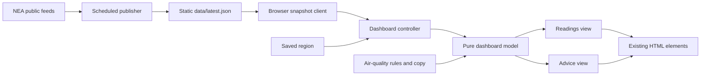

# Architecture

This is a static website with a small browser dashboard. It uses native JavaScript modules. Vite assembles the HTML and bundles the assets; it does not run a production server.

## The data flow



`src/scripts/main.js` connects the pieces. Start there when explaining the code to someone new.

1. The controller reads the saved region and asks the client for readings.
2. The browser client requests one same-site JSON snapshot. The scheduled publisher requests and validates the two upstream feeds independently before deployment.
3. The controller passes the current snapshot, region and time to `createDashboardModel`.
4. The model selects the readings, freshness state, advice and regional labels. It does not access the DOM, browser storage or network.
5. The views put those values into existing elements. User interactions go back to the controller.

No component fetches its own data or calculates its own haze thresholds.

## Source map

| Location                                    | Responsibility                                                              |
| ------------------------------------------- | --------------------------------------------------------------------------- |
| `src/scripts/main.js`                       | Application wiring and tab visibility events                                |
| `src/scripts/config.js`                     | Regions, East default, refresh interval and freshness policy                |
| `src/scripts/services/nea-client.js`        | HTTP requests, cancellation, timeouts and NEA response normalization        |
| `src/scripts/services/snapshot-client.js`   | One same-site browser request, cancellation and timeout                     |
| `src/scripts/domain/reading-snapshot.js`    | Versioned public snapshot validation and numeric-field whitelist            |
| `src/scripts/domain/band-position.js`       | Exact distances to adjacent bands, without inferring trends                 |
| `tooling/publish-snapshot.js`               | Collect source feeds, merge last-good data, write generated deployment JSON |
| `src/scripts/services/region-preference.js` | Read/write the selected region; handle blocked browser storage              |
| `src/scripts/domain/air-quality.js`         | Official band boundaries, PSI labels, freshness and window-advice selection |
| `src/scripts/domain/dashboard-model.js`     | Convert state into the data each view needs                                 |
| `src/scripts/content/`                      | Activity and household advice copy                                          |
| `src/scripts/ui/`                           | DOM references, rendering and event binding                                 |
| `src/sections/`                             | Static page content, grouped by visible section                             |
| `src/sections/masks/`                       | Compact rating overview, expandable comparisons and safe-use notes          |
| `src/partials/`                             | Document head, navigation and footer                                        |
| `src/styles/`                               | Theme, shared styles, component styles and dashboard composition            |
| `public/`                                   | Assets copied unchanged, including favicon and sharing image                |
| `tooling/site-pages.js`                     | Page registry, metadata, internal guide links and generated sitemap         |
| `tooling/`                                  | HTML assembly used by the development server and production build           |
| `tests/unit/`                               | Fast tests without a browser or external network                            |
| `tests/e2e/`                                | Browser tests against the production build                                  |

## The measurement contract

Only the build-time NEA adapter knows raw property names such as `pm25_one_hourly`. The browser receives a versioned public envelope (`version`, `generatedAt`, `readings`) and normalizes it into:

```js
{
  pm25: {
    timestamp: '2026-10-17T10:00:00+08:00',
    values: { north: 20, south: 30, east: 140, west: 80, central: 100 }
  },
  psi: null,
  errors: [{ resource: 'psi', message: 'psi: HTTP 503' }]
}
```

Each measurement can be `null` independently. Individual missing or invalid regional values become `null`; zero is a valid reading. The client rejects malformed responses and selects the newest timestamp if multiple items arrive out of order.

The model accepts only normalized measurements. A provider change belongs in the client adapter and its tests, rather than being patched into the rendering code.

## State and request lifecycle

The controller owns the selected region, current snapshot and loading state. There is one active refresh at a time; repeated requests share its promise. Changing regions during a request is safe because the response is rendered using the latest selected region.

Polling pauses while the tab is hidden. Returning to the tab reevaluates freshness before requesting another snapshot. `destroy()` clears the timer, unbinds events, aborts the request and ignores late results. These behaviours have tests with an injected clock, client and scheduler.

The views cache their element references. Regional buttons remain in the DOM when readings change, so keyboard focus is preserved. Dynamic provider values are assigned with `textContent`, not HTML strings.

## Safety rules and copy

The one-hour PM2.5 bands and the rolling 24-hour PSI remain separate. Current activity and window advice depend on PM2.5; the app never substitutes PSI when PM2.5 is missing.

The two-hour freshness limit and clock-skew allowance are application policies in `config.js`, not NEA health thresholds. Old measurements remain visible with an old-reading label, but current recommendations are withheld.

Window advice is an editorial interpretation of the cited household guidance. It does not calculate indoor air quality, ventilation adequacy or an opening timer. The practical heat exception and source links remain in the static window guide. Keep those explanations consistent when editing the dynamic copy.

## HTML and CSS

`src/index.html` lists sections in reading order. A comment such as `<!-- include: sections/windows.html -->` is expanded before Vite processes the document. Includes are relative to `src/`; nested includes are supported. Missing, out-of-root or circular includes fail the build with a useful error.

`tooling/static-fragments.js` renders region options, regional buttons, the four PM2.5 bands and five PSI categories from the same configuration used by the browser. The model classifies each reading independently and the view updates only text, data attributes and current markers. Their placeholder comments are specific to those repeated components; this is not a general template language. All guides are present in the built HTML, including when JavaScript is disabled.

Each reading has one joined SVG colour bar. `ui/band-scale-view.js` places the pointer at the reported category, not on a linear numeric axis: categories have equal widths and the final category is open-ended. Exact PM2.5 distances remain alongside the bar; they do not imply a trend or safe exposure margin. Stale readings retain an outlined pointer labelled as last reported, without restoring current advice or card tint. Missing values hide the pointer. Walk, mask and higher-risk advice share a compact block below the readings; the longer explanation is a native disclosure.

The shared section navigation is a native sticky bar, not a scroll listener or client-side router. Responsive anchor offsets account for its wrapped mobile layout and enlarged text. The Top link and all section links work without JavaScript. Number readouts use the existing bundled body font with tabular figures; decorative display type is reserved for headings.

`src/styles/main.css` declares the import order. All styles share the `site` cascade layer, retaining the existing specificity and order. `theme.css` contains shared design tokens. `components/` holds shared section styles, `guide-components.css` holds detailed guide components, and `dashboard.css` handles the compact dashboard composition. Responsive rules remain with their relevant defaults or in `responsive.css`. Change a component where its existing rule lives; avoid adding a new override file for each edit.

`tooling/site-pages.js` is the registry for the dashboard and dedicated guides. It provides page-specific metadata, guide introductions, relative navigation links and the sitemap. Vite builds every registered HTML entry. Guide entries reuse the sourced content sections but do not load the dashboard script. Shared placeholders are expanded before Vite handles asset paths; metadata is escaped for HTML and JSON-LD. See [SEO.md](SEO.md) for Search Console setup and editorial/ranking policies.

Vite emits hashed JavaScript and CSS filenames into `dist/`. Treat that directory as disposable build output and never edit or commit it.

`tooling/security-policy.js` adds the production CSP after HTML assembly and asset rewriting. Inline structured metadata is hashed from the final document. Fonts are local, licensed assets under `src/assets/fonts/`; their distribution licences are copied from `public/licenses/`. The development server does not inject this production policy. See [SECURITY.md](../SECURITY.md) for the threat model, scan gates and header-only hosting limits.
